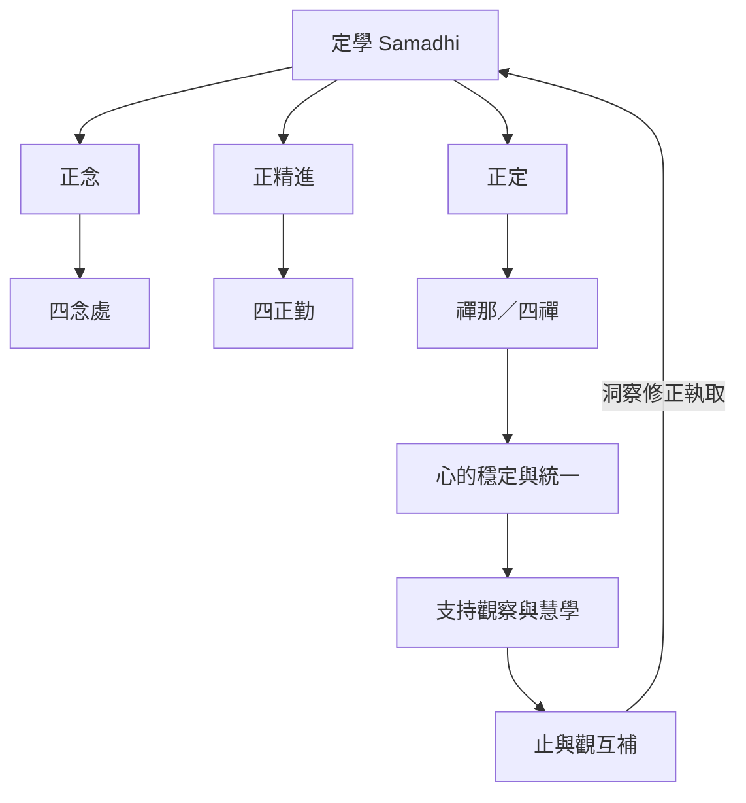

定學的核心是培養穩定、統一與可持續的心。四禪是早期經典對增上心學的重要說明；在實際修習中，正精進、正念與正定彼此支持，止與觀則分別凸顯安定與洞察。定學既不等於一般放鬆，也不應被當作追求特殊經驗或提高效率的技術。

## 雙向連結
- [[note/定學讓心穩定而慧學才得以深入觀察]]
- [[note/正念不是孤立技巧而是八正道中的心智訓練]]
- [[note/定慧雙修指出穩定心與洞察力需要同步發展]]
- [[term/定學是培育心的穩定統一與持續專注]]
- [[term/正念是在正見與正精進支持下清楚覺察當下經驗]]
- [[term/禪那是定學中深層專注與心境轉化的重要形式]]
- [[term/止與觀讓安定心與洞察力互相補足]]
