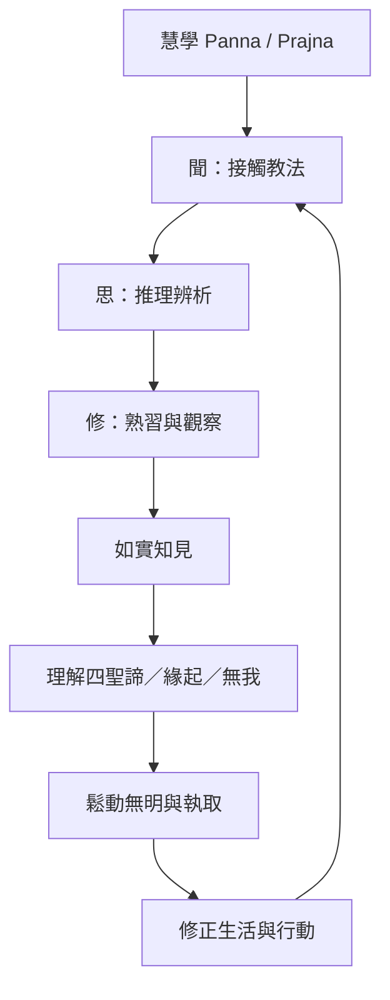

慧學不止於記憶教義，而是把聽聞、思考與親身觀察連結起來，發展對苦、無常、無我、緣起或空性的洞察。不同傳統有各自的教理語言與修證方法；比較時應保留差異，並辨認概念理解與親身洞察之間的距離。

## 雙向連結
- [[note/慧學以如實知苦與緣起鬆動無明而不止於知識累積]]
- [[note/聞思修讓智慧從聽聞理解走向親身驗證]]
- [[note/菩提心使三學朝向利益一切有情而非只求個人寧靜]]
- [[term/慧學是以如實知見理解苦與現象因緣的訓練]]
- [[term/正見是如實理解四聖諦與修道方向的觀點]]
- [[term/般若是洞察緣起無我與空性的智慧]]
- [[term/聞思修是讓智慧經由聽聞思考與實修深化的學習歷程]]
