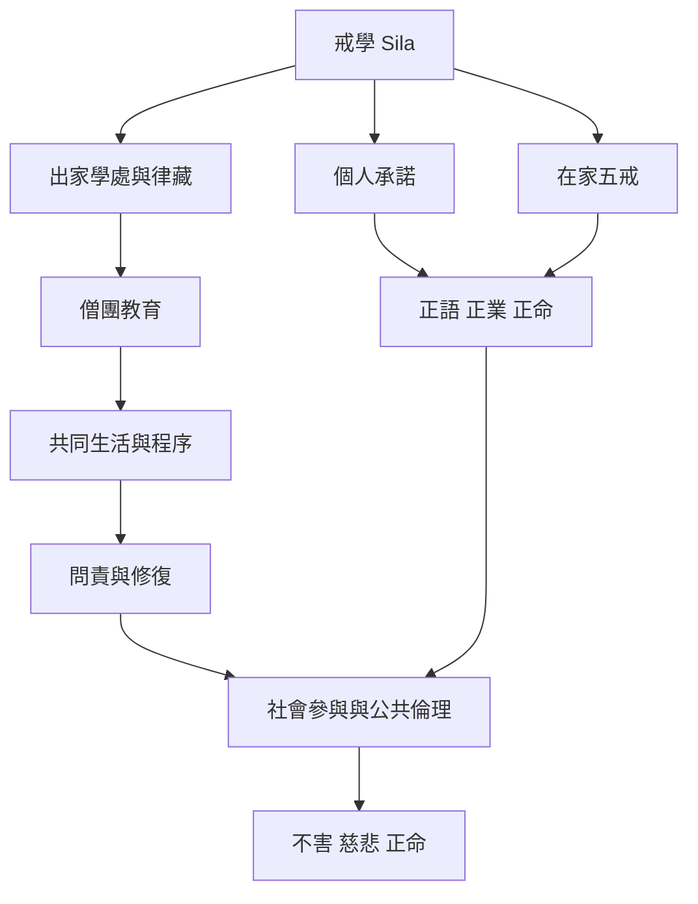

戒學的範圍從個人身語行為延伸到僧團制度、共同生活與社會倫理。理解戒學時要同時看見規範文本、教學與傳承方式、權力關係、性別制度、實際傷害與修復程序。在家五戒與出家律藏不能混為一談，但都涉及持續培育責任與不害。

## 雙向連結
- [[note/戒學是以不害自律與關係責任建立修習的生活基礎]]
- [[note/戒學不能只以外在守規評價而要觀察意向與轉化]]
- [[note/戒學必須處理權力制度與集體生活而不只要求個人自律]]
- [[note/戒學需要透過共同體教育與回饋才能成為活的訓練]]
- [[term/戒學是以不害與自律培育身語行為的訓練]]
- [[term/律藏是僧團制度化戒學的規範與協商資源]]
- [[term/五戒是許多在家佛教徒採用的基本倫理訓練承諾]]
