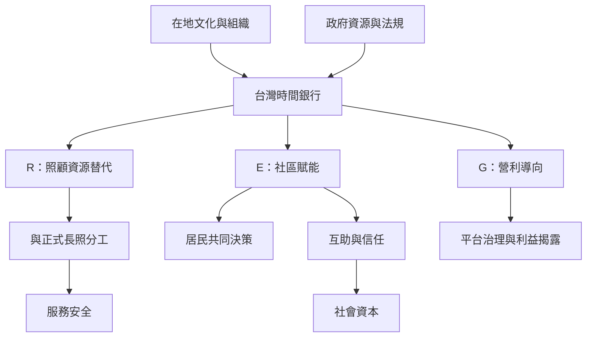

台灣時間銀行的設計需要辨識制度目標、在地互助文化與正式長照體系的關係。R-E-G 三種模式提醒我們，照顧資源替代、社區賦能與營利導向不應混為一談；路中廟等地方案例則顯示，時間銀行需要在地居民、既有組織與長期協調支持。此圖連結 [[時間銀行]]、[[社區信任]]、[[社會包容]]、[[照顧經濟]] 與 [[正式長期照顧]]。

## 思與行
* 針對台灣社區提出方案前，先公開選擇哪一種模式、誰負責協調、點數如何兌換及如何保護服務接受者。
* 把長者自主、志工負擔、居民決策與公共服務責任納入治理規則。

## 參考
* [[台灣研究將時間銀行區分為照顧替代社區賦能與營利導向]]、[[台灣社區換工案例顯示時間銀行能以信任連結不同居民]]
* [[台灣路中廟社區研究呈現時間銀行與共生社區的連結]]、[[中國養老服務時間銀行在制度轉譯中面臨量化治理與勞動異化]]
