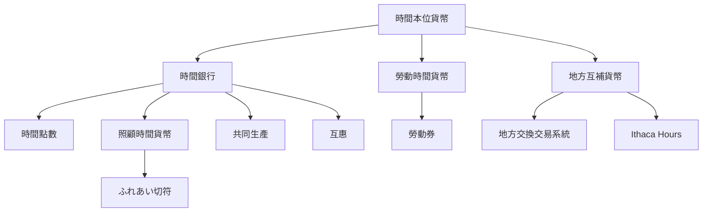

時間本位貨幣是一組以時間作為計價、記帳或交換基礎的制度家族。理解它時，先分辨時間是服務點數、勞動成本，還是地方貨幣面額；再追問制度想達成的是互助、照顧、地方經濟或社會包容。此圖連結 [[時間本位貨幣]]、[[時間銀行]]、[[勞動券]]、[[互補貨幣]]、[[地方交換交易系統]] 與 [[時間點數]]。

主要辨識問題：一點代表什麼？誰創造信用？可兌換什麼？是否能轉讓或換成法定貨幣？制度的核心目的為何？

## 思與行
* 閱讀制度案例時，先用上述五個問題做分類，再比較政策與成效。
* 將時間銀行的社會互助目標與地方貨幣的經濟流通目標分開評估。

## 參考
* [[時間銀行與地方交換交易系統的目標不同但可以互補]]、[[勞動時間貨幣與時間銀行點數不是同一種制度]]
