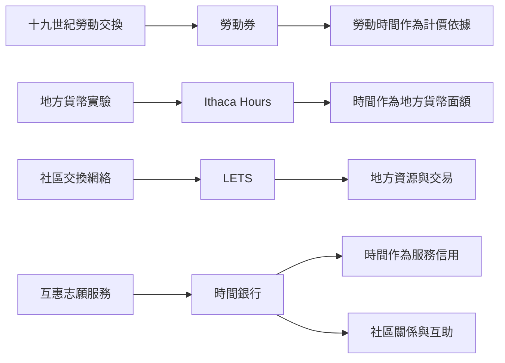

時間本位貨幣的歷史並非單一路徑。十九世紀勞動券試圖以勞動時間計算商品；現代地方紙幣可能以一小時作面額；時間銀行則以時間點數記錄服務請求權。這些制度面對的問題不同：商品供需、地方流通、服務配對與社會互惠不能混為一談。此圖連結 [[勞動券]]、[[Ithaca_Hours]]、[[地方交換交易系統]]、[[互補貨幣]] 與 [[時間銀行]]。

## 思與行
* 閱讀貨幣史時，辨認不同制度創造信用、發行貨幣與處理供需的方式。
* 不以「時間是共同尺度」推論不同制度在經濟效果上可以互換。

## 參考
* [[十九世紀勞動券實驗提醒時間貨幣需要供需匹配]]、[[地方時間紙幣Ithaca Hours以貨幣面額而非服務點數運作]]
* [[時間銀行與地方交換交易系統的目標不同但可以互補]]
