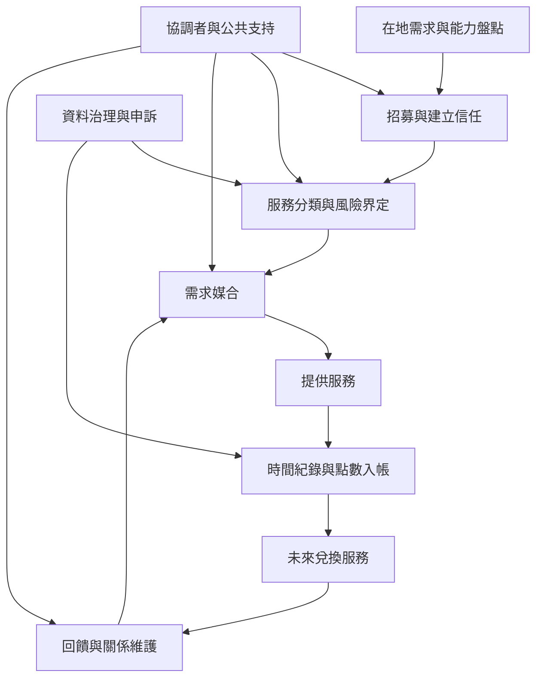

時間銀行的運作可拆成成員加入、需求與能力辨識、服務媒合、時間紀錄、點數兌換、衝突處理與組織維護等環節。每一個環節都包含信任與責任，不是單靠帳本便能完成。概念上連結 [[時間銀行]]、[[時間點數]]、[[互惠]]、[[共同生產]]、[[社區信任]] 與 [[時間信用折現]]。

制度的主要失靈點可能是供需不匹配、協調資源不足、風險責任不清、點數無法兌換或服務被過度量化。

## 思與行
* 先以少量低風險服務驗證流程，再擴充到更複雜的互助。
* 每季檢查服務供需、活躍會員、協調者負荷、未使用點數與申訴紀錄。

## 參考
* [[時間銀行需要有人維護互惠關係的基礎設施]]、[[時間銀行的瓶頸常發生在供需匹配而非點數計算]]
* [[時間銀行不能取代專業照顧與公共保障]]、[[數位工具可以增加媒合能力卻不能取代人際信任]]
