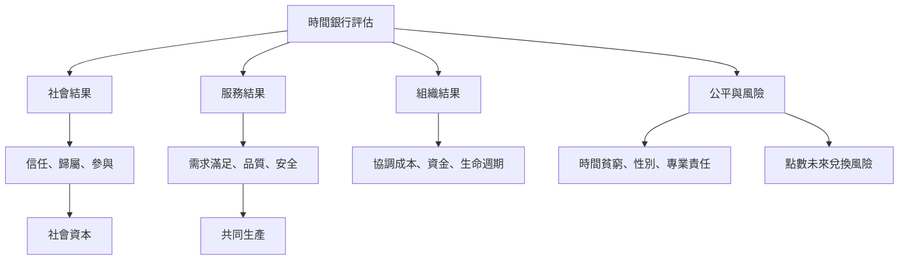

時間銀行的評估必須同時觀察社會結果、服務品質、組織能力、制度成本與點數承諾。社會資本可能增加，但會員規模不等於關係品質；交換量可能提高，但不代表服務公平；組織存續很久，也不代表仍完成使命。此圖連結 [[社會資本]]、[[時間貧窮]]、[[時間信用折現]]、[[時間銀行]] 與 [[共同生產]]。

## 思與行
* 使用量化與質性資料互補，並追蹤退出者與未參與者。
* 在每年度報告中同時公開成果、成本、服務缺口與失敗經驗。

## 參考
* [[時間銀行的證據應以研究設計與測量品質分層解讀]]、[[時間銀行的生命週期比單一規模指標更能解釋制度變化]]
* [[時間銀行的核心產出是互惠網絡而非地方貨幣流通量]]
