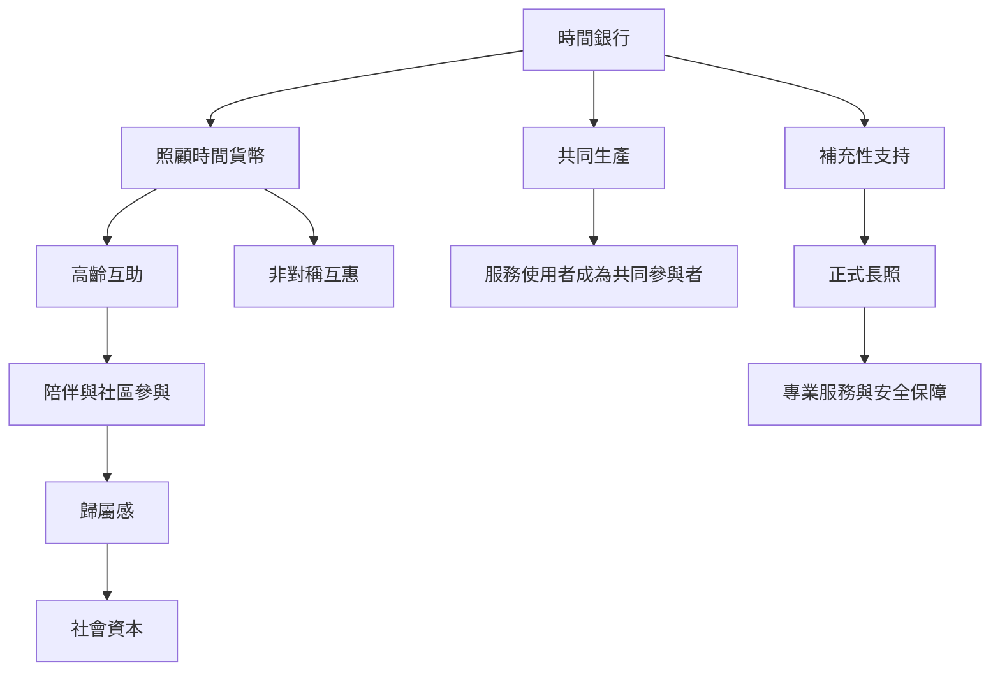

時間銀行常被用於老人照顧與社區互助，但它的社會價值需要透過人際關係、歸屬感、互惠與自主參與發生。照顧時間貨幣可以協助連結照顧者與接受者，卻不能替代專業長照。此圖連結 [[照顧時間貨幣]]、[[ふれあい切符]]、[[核心經濟]]、[[照顧經濟]]、[[社會資本]] 與 [[社會包容]]。

## 思與行
* 以「補充正式服務、增加關係支持、保留接受者主體性」作為高齡互助制度的三項檢核。
* 將照顧者的時間壓力與性別分工納入成果評估。

## 參考
* [[日本ふれあい切符證明照顧時間貨幣具有不同歷史與操作模式]]、[[老年照顧時間銀行的跨國研究支持社會價值但研究品質中等]]
* [[時間銀行不能取代專業照顧與公共保障]]、[[性別分工會影響時間銀行中的照顧勞動分配]]
