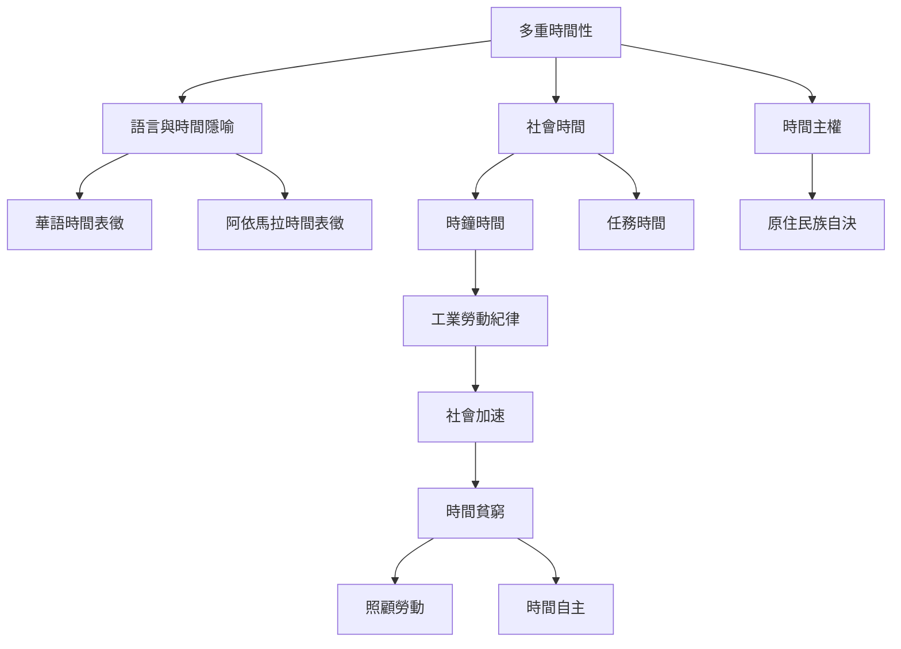

本圖從個人時間隱喻擴展到工作制度、時間資源分配與群體自決。時間不是只有心理感受，也是一種被制度分配、協商與爭取的資源。

雙向連結：[[語言提供時間的空間座標]]、[[時間制度會分配權力而不只是安排日程]]、[[時間貧窮是時間資源分配不均的問題]]、[[生活設計應同時照顧時間自主與共同節律]]。

## 參考
* 全書導讀：[[Time_perception]]。
* [[工業資本主義將任務節奏轉化為可計量的勞動時間]]。
* [[原住民族時間主權涉及歷史敘事與未來自決]]。
* [[時間貧窮與匆忙感是不同且不平均分配的資源壓力]]。
