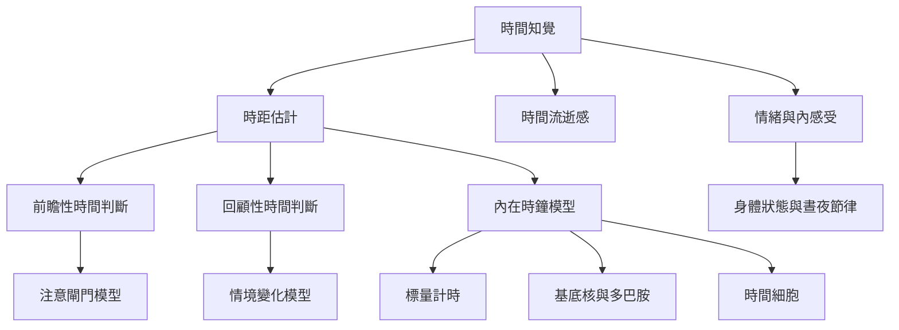

本概念地圖整理時間感的心理測量與神經計時機制。核心提醒是：時距估計、時間流逝感、前瞻性與回顧性判斷彼此相關，但不是同一個變項。

雙向連結：[[時間知覺不是單一內在時鐘]]、[[時距估計與時間流逝感是兩種不同的主觀判斷]]、[[注意力與記憶形成兩條不同的時間判斷路徑]]、[[身體狀態讓時間感具有節律性]]、[[情緒會改變時間經驗但效果受任務條件限制]]。

## 參考
* 全書導讀：[[Time_perception]]。
* [[大腦以分散式神經網路處理時間而非依賴單一器官]]。
* [[內在時鐘模型有解釋力但不是唯一的神經計時理論]]。
