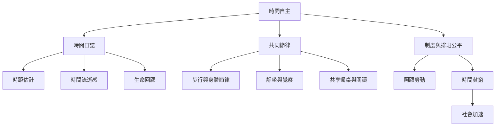

本圖把時間研究轉成可實踐的生活問題：如何辨認自己的時間感、安排身體節律、照顧共同生活，並減少時間制度造成的壓力。

雙向連結：[[生活設計應同時照顧時間自主與共同節律]]、[[步行練習可以把身體節律作為時間覺察的入口]]、[[共享餐桌與讀書聚會可以創造不以效率衡量的共同時間]]、[[社群排班應衡量時間自主而不只統計志工時數]]。

## 參考
* 全書導讀：[[Time_perception]]。
* [[日常減速應改變時間關係而非追求更慢的效率]]。
* [[時間貧窮是時間資源分配不均的問題]]。
* [[研究禪修時間感應採用多指標與可比較的設計]]。
