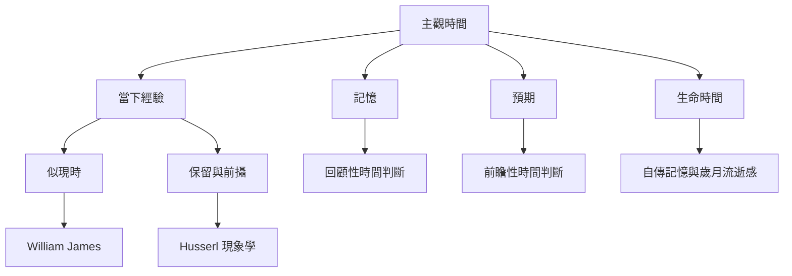

本圖連結心理學的似現時、現象學的保留／前攝，以及記憶、預期與主觀時間。不同理論都說明「現在」具有結構，但其方法論與哲學主張並不相同。

雙向連結：[[當下不是無延展的數學瞬點]]、[[時間日誌應分開記錄估時流逝感與生命回顧]]、[[記憶中的事件密度會影響回顧時間的長短]]。

## 參考
* 全書導讀：[[Time_perception]]。
* [[當下經驗包含剛逝去的內容與即將到來的預期]]。
* [[保留與前攝讓意識經驗具有時間連續性]]。
* [Stanford Encyclopedia of Philosophy: The Experience and Perception of Time](https://plato.stanford.edu/entries/time-experience/)。
