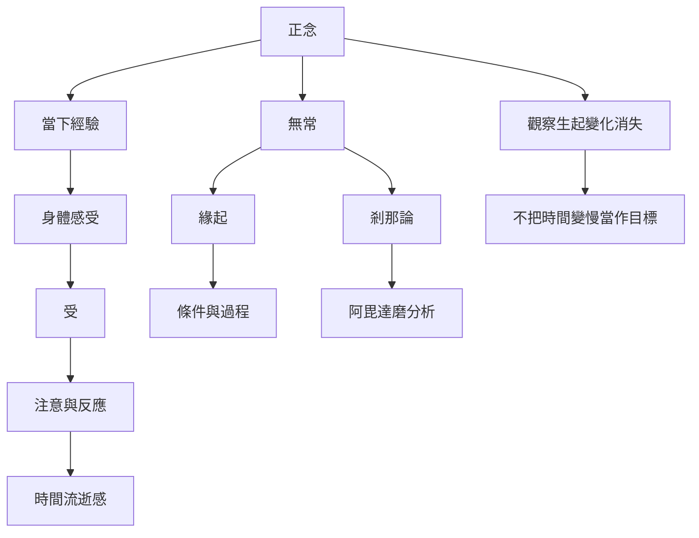

本圖將當下覺察、時間經驗與佛教無常思想並置，但保留教義層次差異：早期經典的過程性無常不等於後期部派剎那論，也不等於實驗心理學的時距估計。

雙向連結：[[正念可能改變人與時間的關係而不只是改變時間速度]]、[[無常是對變化過程的觀察而非單純時間切片]]、[[靜坐時可以觀察等待感而不把時間變慢當成目標]]。

## 參考
* 全書導讀：[[Time_perception]]。
* [[正念與時間知覺的關係取決於測量方式與時間尺度]]。
* [[佛教早期無常觀與部派阿毘達磨剎那論不應混為一談]]。
* Bhikkhu Anālayo, [On Time](https://www.buddhistinquiry.org/article/on-time/)。
