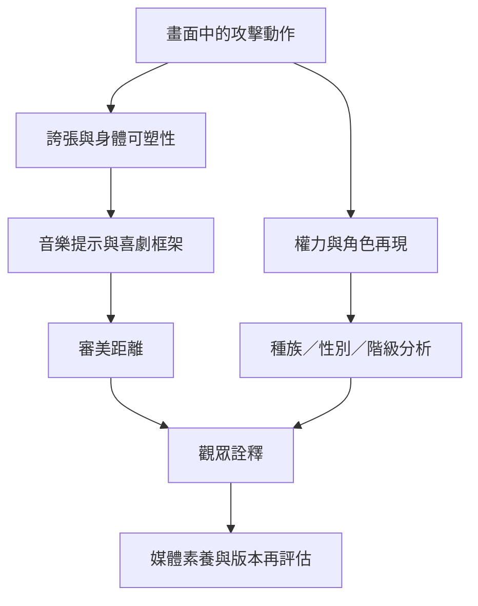

暴力喜劇可以因身體可塑性、音樂、無後果恢復與審美距離而變得可笑，但也可能延續種族、性別與階級刻板印象。分析不能只停留在「好笑」或「有害」二分法。

相關筆記：[[動畫暴力之所以可笑取決於敘事框架而非只看動作]]、[[家庭喜劇中的配角也承載種族與階級的歷史痕跡]]、[[經典動畫的重播與剪輯會反映時代規範的變動]]。

## 延伸連結
* [[以分離聲畫的方法重新聽見卡通中的暴力]]
* [[把經典動畫當作媒體素養與歷史閱讀教材]]
