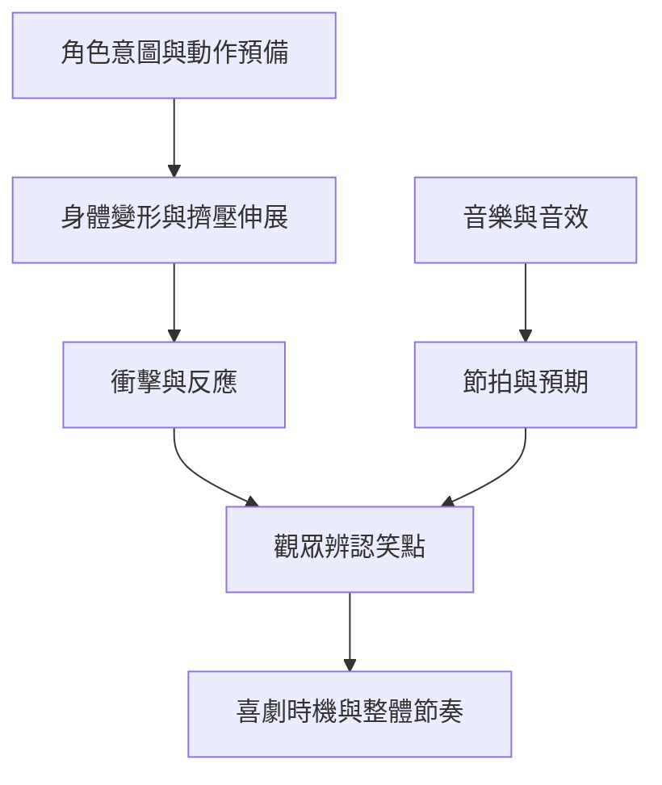

觀看 Tom and Jerry 的動作，需要同時分析身體如何變形、笑點如何安排，以及音樂和音效如何引導觀眾。這幾個因素不是互不相干的技術，而是同一場表演的不同層次。

相關筆記：[[滑稽追逐把角色身體變成可以任意重塑的動畫材料]]、[[喜劇節奏由預備停頓衝擊與反應共同組成]]、[[配樂與音效不是陪襯而是共同編寫動作的敘事者]]。

## 延伸連結
* [[動畫暴力之所以可笑取決於敘事框架而非只看動作]]
* [[把 Tom and Jerry 當作觀察身體覺察與動作節奏的練習材料]]
