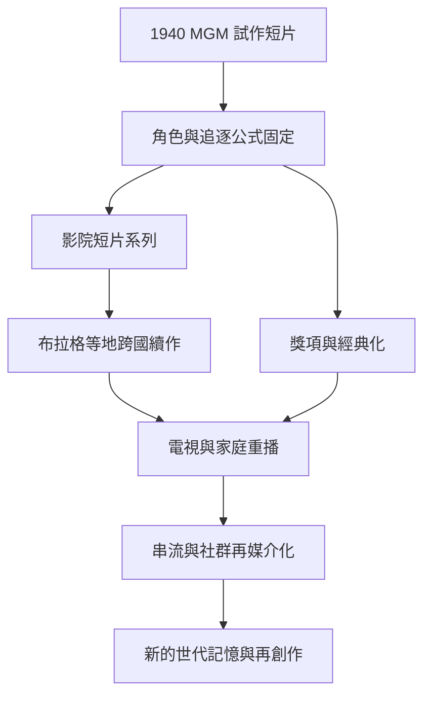

Tom and Jerry 的歷史不只是角色傳記，而是工作室、導演、發行媒介和觀眾共同塑造的系列史。從 MGM 短片開始，後續的跨國製作與電視重播，使作品不斷被重新定義。

相關筆記：[[一部短片的角色原型會在系列化過程中逐漸固定]]、[[同一動畫品牌會在跨國製作中形成不同美學]]、[[系列的長壽來自可辨識角色與可變動的文化用途]]、[[獎項肯定呈現了經典短片在動畫工業中的地位]]。

## 延伸連結
* [[Tom 與 Jerry 的固定衝突提供了可不斷變奏的敘事引擎]]
* [[經典動畫的重播與剪輯會反映時代規範的變動]]
