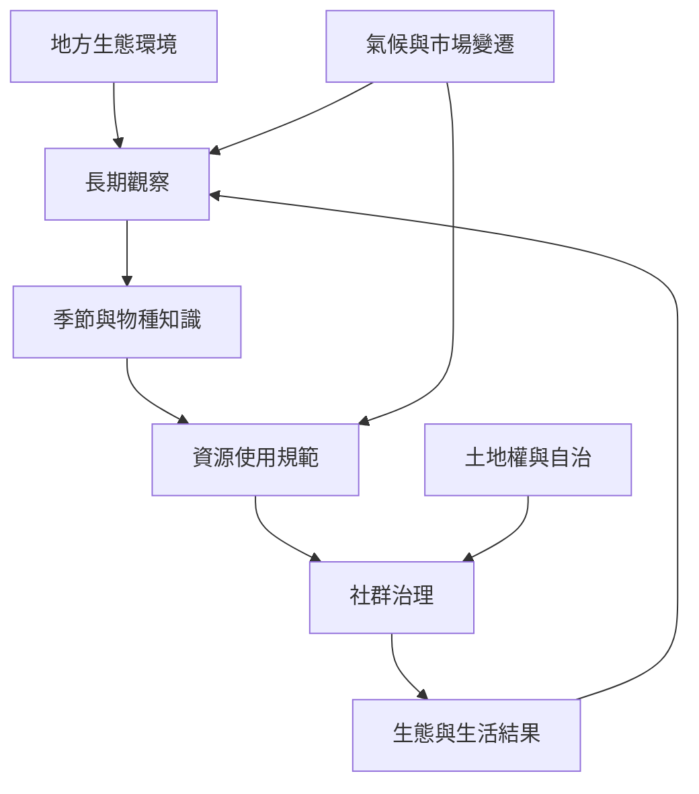

跨區域案例顯示，傳統生態知識不是一套可跨地區複製的技術。它依地形、季節、物種、歷史和社群制度而變化，可能透過火管理、海冰判讀、季節預測、農作物組合、森林保護、灌溉或放牧實踐。

## 關係圖

## 概念連結
* [[term/傳統生態知識是社群與環境互動形成的地方知識系統]]
* [[term/共同資源治理需要持續協商與地方制度]]
* [[term/季節性放牧是依氣候與牧草變化移動牲畜的知識實踐]]
* [[term/Milpa 是中美洲以玉米豆類南瓜等作物構成的複合農業系統]]
* [[term/文化火管理是原住民族依地方知識進行的用火與土地照護]]

## 延伸論點
* [[note/傳統知識與生物多樣性的連結來自治理實踐而不只來自知識內容]]
* [[note/傳統制度的社會功能不一定等同於資源保育功能]]
* [[note/傳統知識與科學知識可以互補但不必互相化約]]

## 思與行
* 將此圖當作暫時模型：每加入新案例，都檢查它是否支持、修正或挑戰現有連線。
* 不把圖中的箭頭理解為單向因果；社群、土地、制度與知識會彼此回饋。

## 參考
* 本書導讀：[[Traditional_knowledge]]
