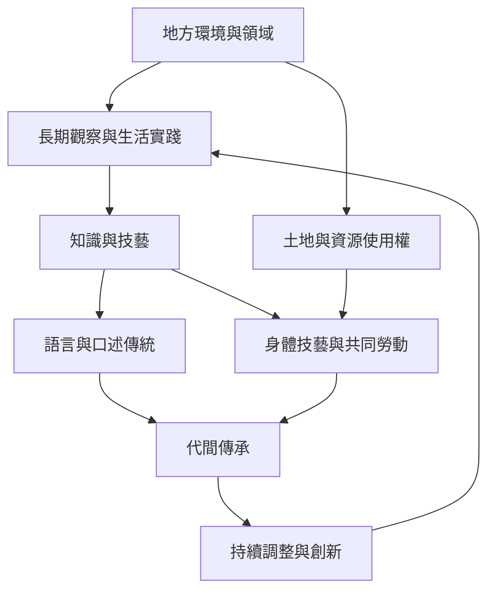

傳統知識由多個互相支撐的條件組成：地方環境提供觀察與實作場域；語言、口述傳統與身體技藝傳遞經驗；共同勞動與社群制度讓知識得以被使用與修正。若土地與實踐機會被切斷，單靠典藏難以延續完整知識系統。

## 關係圖

## 概念連結
* [[term/傳統知識是跨世代累積且持續演變的社群知識]]
* [[term/口述傳統是以表演維繫社群記憶的知識形式]]
* [[term/傳統生態知識是社群與環境互動形成的地方知識系統]]
* [[term/Mātauranga Māori 是持續演變的 Māori 知識生態系]]

## 延伸論點
* [[note/知識與土地水域及生活路徑的關係使它無法脫離地方脈絡]]
* [[note/知識傳承最有力的場域往往是共同勞動而非單向講授]]
* [[note/口述傳承傳遞的不只是資訊還包含判斷情境與表演能力]]

## 思與行
* 將此圖當作暫時模型：每加入新案例，都檢查它是否支持、修正或挑戰現有連線。
* 不把圖中的箭頭理解為單向因果；社群、土地、制度與知識會彼此回饋。

## 參考
* 本書導讀：[[Traditional_knowledge]]
