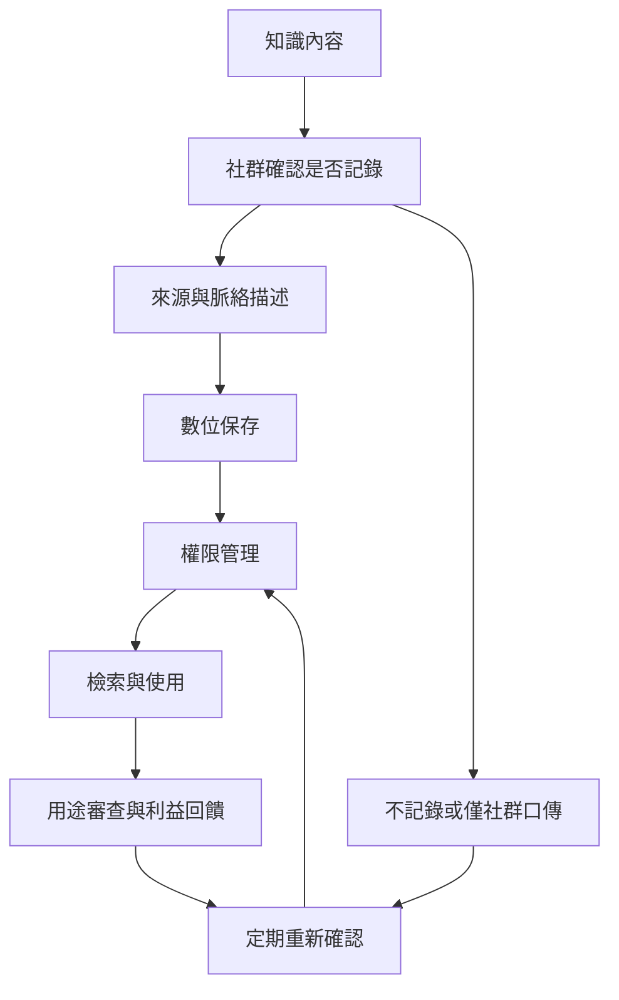

數位化能擴大保存、檢索與教育用途，但也會改變知識的流通方式。可靠的數位保存必須把來源、持有者、語言、情境、使用目的、授權狀態、存取層級與再利用限制一起保存。

## 關係圖

## 概念連結
* [[term/CARE 原則把原住民族資料治理放回集體利益與自決]]
* [[term/防禦性知識資料庫以既有文獻降低傳統知識遭錯誤授予專利的風險]]
* [[term/原住民族資料主權使資料開放受到社群權利約束]]

## 延伸論點
* [[note/數位典藏能保護知識也可能改變知識的脈絡與控制權]]
* [[note/防禦性知識資料庫不能取代持有者對後續利用的決定權]]

## 思與行
* 將此圖當作暫時模型：每加入新案例，都檢查它是否支持、修正或挑戰現有連線。
* 不把圖中的箭頭理解為單向因果；社群、土地、制度與知識會彼此回饋。

## 參考
* 本書導讀：[[Traditional_knowledge]]
