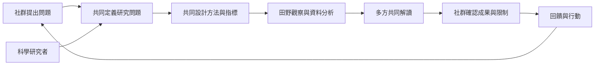

知識共製要求不同知識持有者共同決定問題、方法、解讀與成果，而不是只把地方知識和科學資料放在同一份報告。共製關注權力、責任、時間、語言與利益如何分配。

## 關係圖

## 概念連結
* [[term/認識論多元主義承認不同知識傳統的證據與世界觀]]
* [[term/自由事先知情同意要求研究與使用建立在有效同意之上]]

## 延伸論點
* [[note/傳統知識與現代科學合作應從研究問題與方法設計階段開始]]
* [[note/傳統知識與科學知識可以互補但不必互相化約]]

## 思與行
* 將此圖當作暫時模型：每加入新案例，都檢查它是否支持、修正或挑戰現有連線。
* 不把圖中的箭頭理解為單向因果；社群、土地、制度與知識會彼此回饋。

## 參考
* 本書導讀：[[Traditional_knowledge]]
