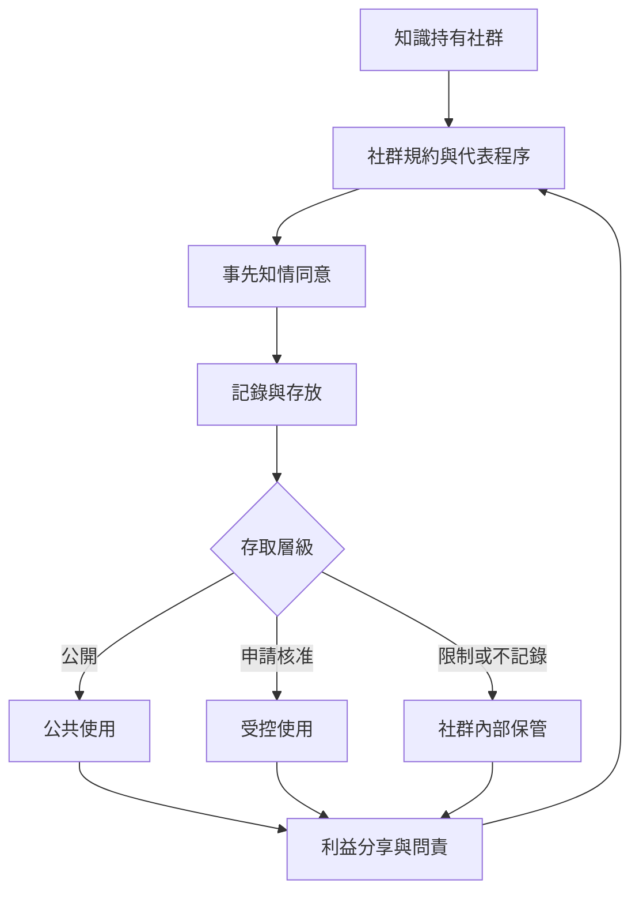

傳統知識治理不只是著作權或資料庫管理，而是社群對知識的取得、描述、存放、存取、再利用與利益分享所擁有的決策權。有效治理需要同意、社群規約、分層權限、問責與可撤回安排。

## 關係圖

## 概念連結
* [[term/知識主權是社群決定知識如何被治理的集體權利]]
* [[term/自由事先知情同意要求研究與使用建立在有效同意之上]]
* [[term/CARE 原則把原住民族資料治理放回集體利益與自決]]
* [[term/社群規約讓知識持有者定義存取與利益分享條件]]

## 延伸論點
* [[note/研究者應先確立同意程序再開始記錄與利用傳統知識]]
* [[note/開放資料原則不能凌駕原住民族對資料的集體治理權]]
* [[note/利益分享不只支付酬勞也包括決策權能力建置與成果回饋]]

## 思與行
* 將此圖當作暫時模型：每加入新案例，都檢查它是否支持、修正或挑戰現有連線。
* 不把圖中的箭頭理解為單向因果；社群、土地、制度與知識會彼此回饋。

## 參考
* 本書導讀：[[Traditional_knowledge]]
