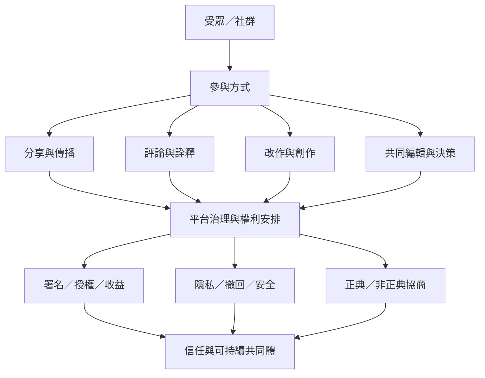

受眾參與不只是互動功能，而是內容創作、詮釋權、平台規則與利益分配的治理問題。從使用者生成內容到粉絲社群共創，需辨識參與者是否具有實質決定權。

延伸閱讀：[[參與式文化]]、[[使用者生成內容]]、[[粉絲創作]]、[[正典]]、[[跨媒介素養]]、[[受眾參與需要從消費者模型轉向共同創作者模型]]、[[共同創作必須讓社群保有敘事決定權]]、[[跨媒介敘事需要分析權力與商業模式]]。

* 本書導讀：[[Transmedia_storytelling]]。
