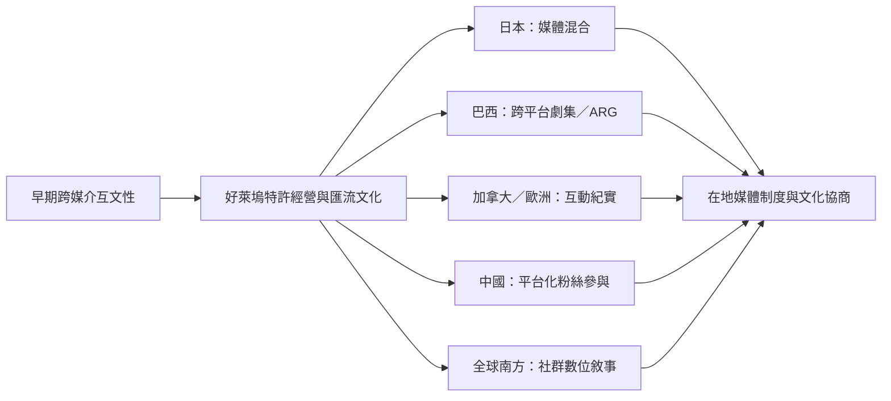

跨媒介敘事不只是一條從好萊塢走向數位平台的路徑。概念史包括早期跨媒介互文性、北美商業系列、日本媒體混合、拉丁美洲製作實驗、歐洲新聞與教育研究，以及亞洲平台化粉絲文化。

此圖是比較路徑而非單一擴散史。延伸閱讀：[[跨媒介互文性]]、[[媒體混合]]、[[跨媒介敘事的歷史不應被縮減為數位媒體史]]、[[跨媒介敘事的定義仍有爭議且必須同時看見產業與受眾]]、[[跨媒介敘事可以服務公共議題而非只服務娛樂品牌]]。

* 本書導讀：[[Transmedia_storytelling]]。
