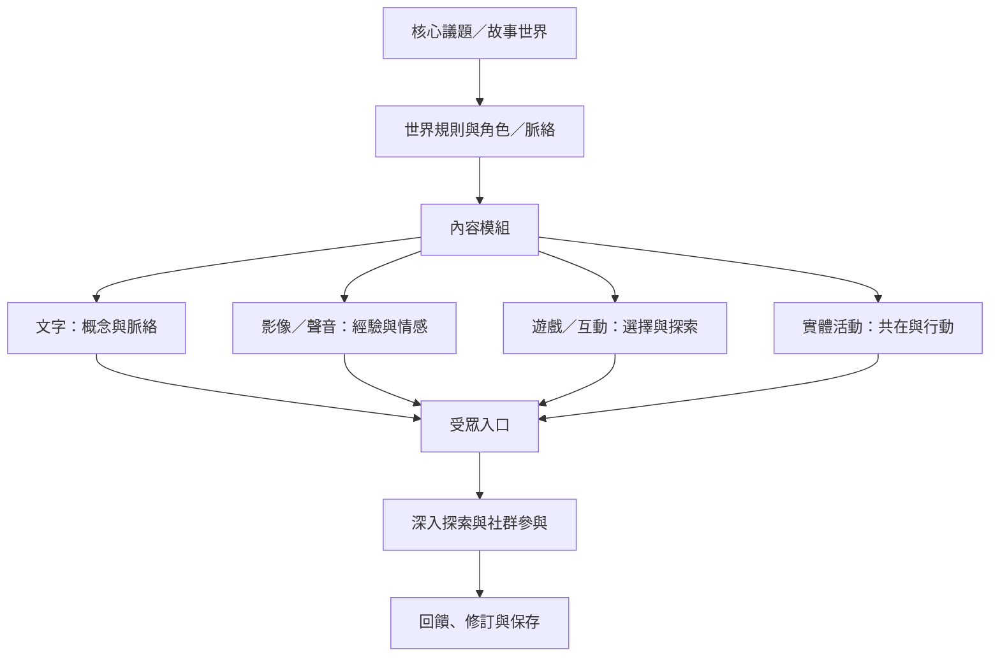

跨媒介敘事設計可由「世界—內容—媒介—旅程」四層理解。先界定故事世界或公共議題，再決定不同媒介各自承擔什麼內容，接著設計受眾如何從入口走向深入探索與參與。

設計判準是媒介是否互補，而非平台數量。延伸閱讀：[[跨媒介敘事]]、[[故事世界]]、[[媒體匯流]]、[[連載性]]、[[跨媒介敘事的判準是媒介貢獻而非媒介數量]]、[[每種媒介應發揮不同的敘事優勢]]、[[跨媒介敘事應同時設計廣泛入口與深入探索]]、[[跨媒介專案需要一份可協作的製作聖經]]。

* 本書導讀：[[Transmedia_storytelling]]。
