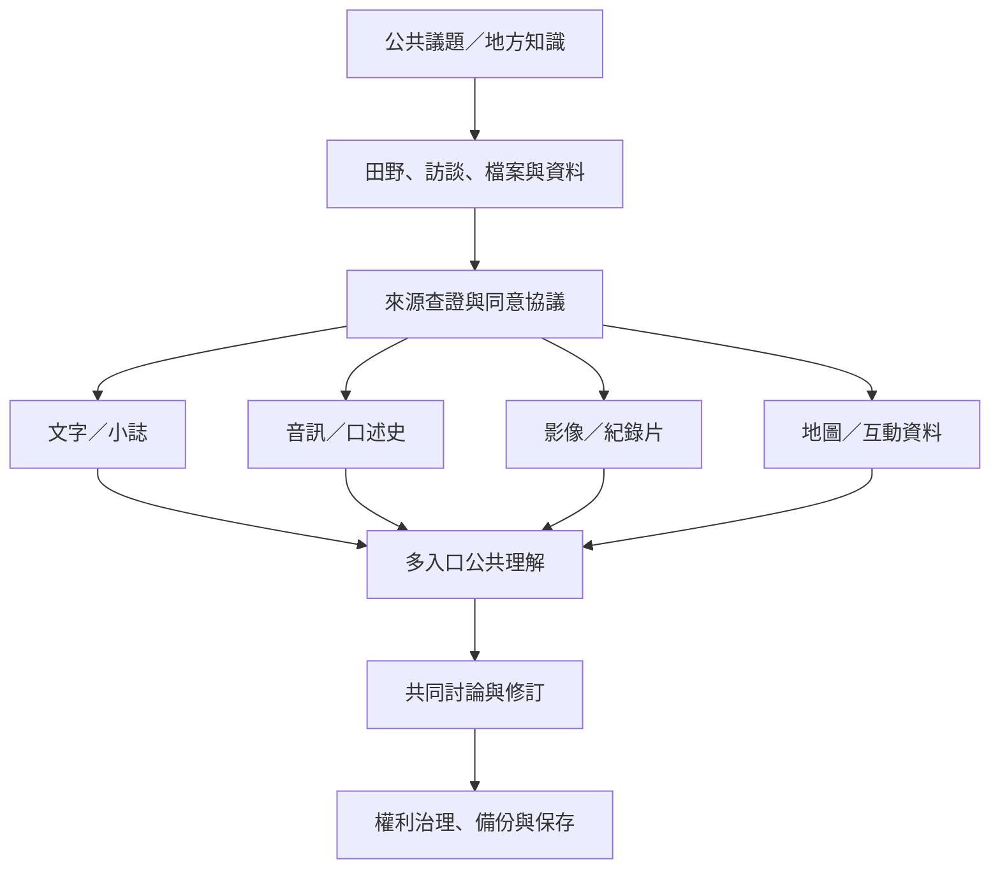

非虛構跨媒介敘事的中心不是虛構世界規則，而是可查證的資料、當事人權利與多種表達入口。互動、沉浸與投稿必須與證據鏈、同意及保存策略並行。

延伸閱讀：[[互動紀錄片]]、[[沉浸性]]、[[地方知識可以透過多種媒介成為共同敘事]]、[[非虛構跨媒介敘事必須讓證據與素材來源可追溯]]、[[平台依賴使跨媒介作品面臨保存風險]]。

* 本書導讀：[[Transmedia_storytelling]]。
