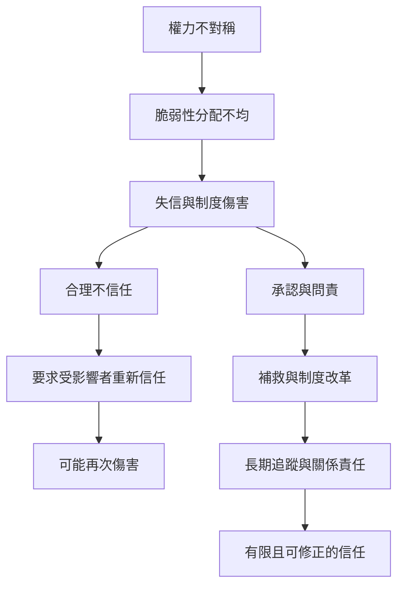

信任與權力不可分離。制度若長期把風險轉嫁給弱勢者，或要求受傷者先相信它，信任便可能成為服從工具。可信任的修復需要改變權力配置與責任制度。

重要的倫理問題不是如何說服人們相信，而是誰承擔修復成本、誰能拒絕、誰能退出。請連讀[[權力不對稱會改變信任所承擔的風險]]、[[有時拒絕信任是合理的自我保護]]、[[健康研究應優先建立制度可信性而非要求弱勢群體增加信任]]及[[把信任修復設計成承認補救與長期追蹤]]。

相關概念：[[權力不對稱 Power Asymmetry]]、[[認識論不正義 Epistemic Injustice]]、[[關係責任 Relational Accountability]]、[[問責 Accountability]]、[[信任修復 Trust Repair]]。
