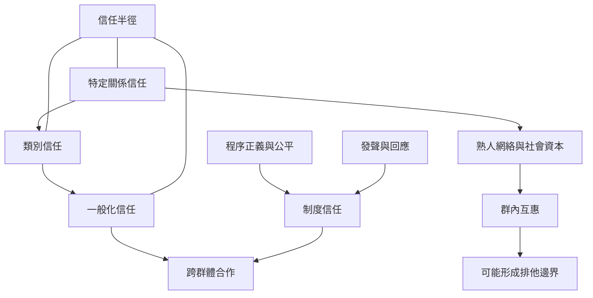

信任具有不同社會尺度：從親密關係到熟人網絡、社會角色、陌生人與公共制度。信任半徑並非單純擴張的同心圓；群體邊界、文化脈絡與制度公平都會改變信任流動。

閱讀時先區分[[特定關係信任 Particularized Trust]]、[[類別信任 Categorical Trust]]與[[一般化信任 Generalized Trust]]，再閱讀[[熟人信任不會自動轉化為陌生人信任]]與[[信任半徑決定合作能跨越多大的社會距離]]。制度面則連結[[制度信任來自可感受到的公平回應與參與]]、[[容忍共存與信任合作是不同的社會關係]]。

相關概念：[[信任半徑 Radius of Trust]]、[[社會資本 Social Capital]]、[[互惠 Reciprocity]]、[[合作 Cooperation]]、[[制度信任 Institutional Trust]]、[[程序正義 Procedural Justice]]。
