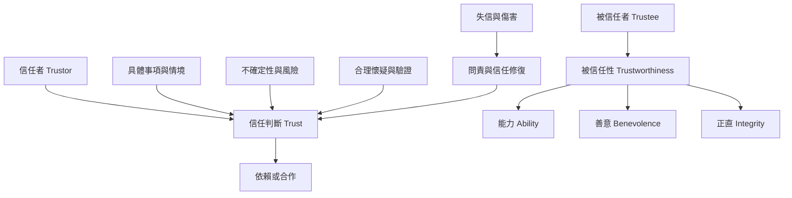

信任的分析起點是區分信任者、被信任者、具體事項與未知結果。此圖連結信任、被信任性、風險、合理懷疑與修復：信任是一種承擔脆弱性的選擇，被信任性則是對方是否真的值得承擔。

核心閱讀順序：先讀[[信任是承擔脆弱性而不是確定對方不會傷害自己]]，再讀[[信任必須指明信任者被信任者與具體事項]]與[[被信任性包含能力善意與正直]]，最後連到[[信任需要隨風險大小調整範圍]]、[[合理懷疑能協助信任校準]]及[[有時拒絕信任是合理的自我保護]]。

相關概念：[[信任 Trust]]、[[被信任性 Trustworthiness]]、[[不信任 Distrust]]、[[警覺性不信任 Mistrust]]、[[信任校準 Trust Calibration]]、[[信任修復 Trust Repair]]。
