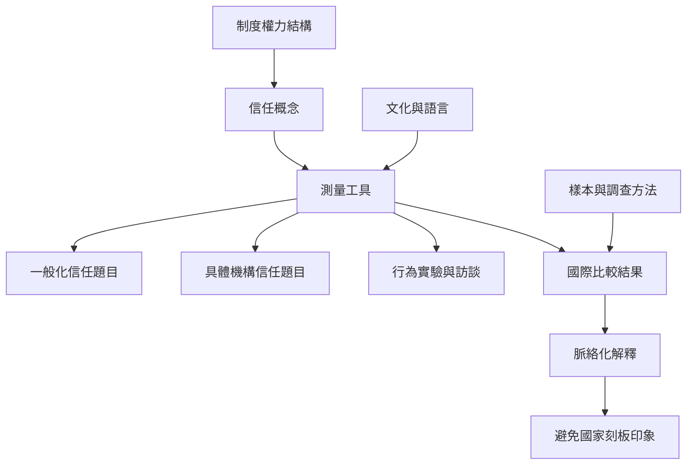

全球信任比較必須同時考慮題目設計、文化翻譯、制度結構、社會距離與國內差異。跨國平均值是比較的入口，不是對整個社會的本質描述。

閱讀順序：[[世界價值觀調查的信任題目適合追蹤趨勢但不能代表所有信任]]、[[制度信任的測量方式本身會形塑我們看見的信任危機]]、[[東亞信任結構不能直接套用西方制度分類]]，再比較[[非洲跨國調查顯示信任會隨社會距離增加而下降]]、[[拉丁美洲制度信任呈現機構差異與國家內部差異]]與[[全球科學信任與人們的生活條件及制度經驗相連]]。

相關概念：[[一般化信任 Generalized Trust]]、[[制度信任 Institutional Trust]]、[[信任測量必須考慮文化與制度脈絡]]、[[信任不是單一總分可以完整描述的狀態]]。
