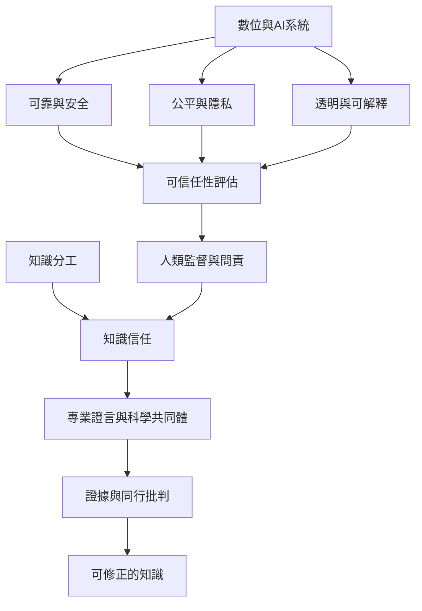

知識社會必須依賴專業與技術系統，但依賴不等於盲從。可信任的知識與數位系統需要來源可追溯、限制可理解、偏差可監測、錯誤可修正與責任可追究。

先讀[[知識信任是一種合理的認知依賴]]，再讀[[科學信任需要制度可信而不只是科學知識正確]]、[[數位信任必須由可驗證的系統特徵支撐]]與[[用三層風險設計人機協作中的信任門檻]]。對共享知識的倫理，接續閱讀[[知識生產的信任需要共享決定權與成果]]。

相關概念：[[知識信任 Epistemic Trust]]、[[科學信任 Trust in Science]]、[[數位信任 Digital Trust]]、[[透明性 Transparency]]、[[問責 Accountability]]、[[信任校準 Trust Calibration]]。
