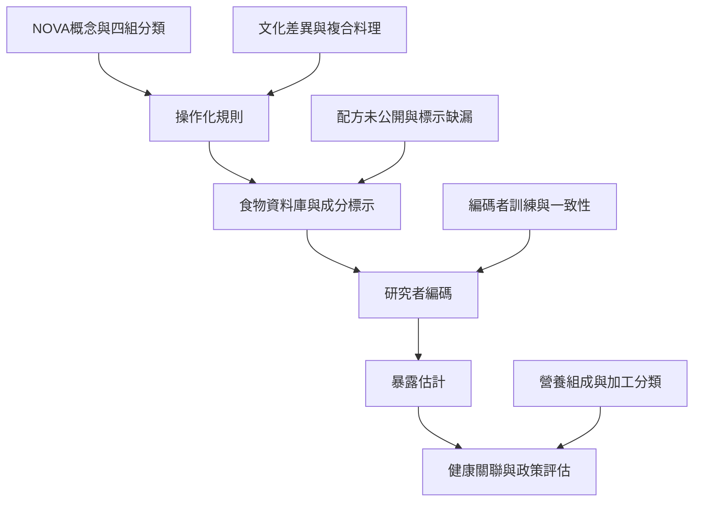

NOVA 具有辨識工業食品配方與食品系統變化的公共衛生價值，但應處理分類規則、跨文化適用性、資料來源與編碼一致性的問題。研究中的分類誤差可能影響暴露估計，也會影響政策標準的可執行性。

從 [[NOVA食品分類由加工程度與目的區分四組食品]] 開始，對照 [[食品科學界質疑NOVA的界線與可操作性]] 和 [[食品分類工具必須可重複且適用於不同文化食物]]。台灣的研究與治理問題可參考 [[監察院指出台灣超加工食品管理與本土研究仍有缺口]]，並延伸到 [[為台灣建立跨族群食品加工資料庫與編碼共識]]。

## 延伸概念
[[NOVA食品分類]]、[[營養流行病學]]、[[食品加工]]、[[食品標示]]。
