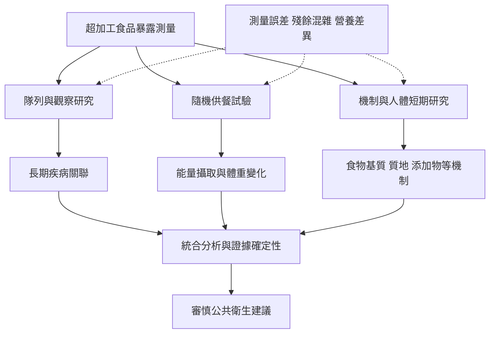

超加工食品與健康的研究應同時閱讀觀察研究、隨機試驗與機制研究。觀察研究能追蹤長期人口結果，供餐試驗能測試短期飲食條件，機制研究能探索食物基質、質地與添加物路徑；三種方法的推論範圍不同。

先讀 [[超加工食品健康證據廣泛但因果推論仍需分層]]，再比較 [[隨機供餐試驗顯示超加工飲食可增加自由攝食與體重]]、[[英國八週交叉試驗發現最低加工飲食帶來較大體重下降]] 與 [[2026年隨機試驗統合分析指出能量密度可能解釋部分差異]]。對特定機制，可讀 [[食物基質與質地會影響進食速度與能量攝取]] 和 [[健康風險不應被簡化為單一添加物有毒]]。

## 延伸概念
[[營養流行病學]]、[[能量密度]]、[[進食速度]]、[[食物基質]]、[[食品添加物]]。
