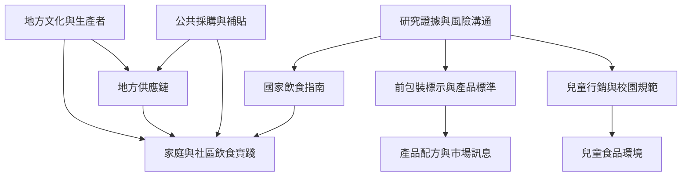

不同國家對超加工食品的治理路徑並不相同。巴西將加工程度放進飲食指南；拉丁美洲多國採用前包裝營養警示標示與廣告限制；《The Lancet》2025 系列提出食品環境與供應鏈層次的綜合政策。政策工具需要依各地食品系統、食物文化與社會不平等調整。

以 [[巴西2014年飲食指南以整體飲食模式取代單看營養素]] 為政策案例，再讀 [[2025年Lancet系列將超加工食品視為食品系統與商業權力議題]]。在台灣，先掌握 [[監察院指出台灣超加工食品管理與本土研究仍有缺口]]，再設計 [[設計超加工食品政策沙盒比較標示補貼與供餐採購]] 與 [[公共採購可同時改變飲食品質與地方供應鏈]]。

## 延伸概念
[[食品主權]]、[[食品環境]]、[[食物素養]]、[[飲食轉型]]。
