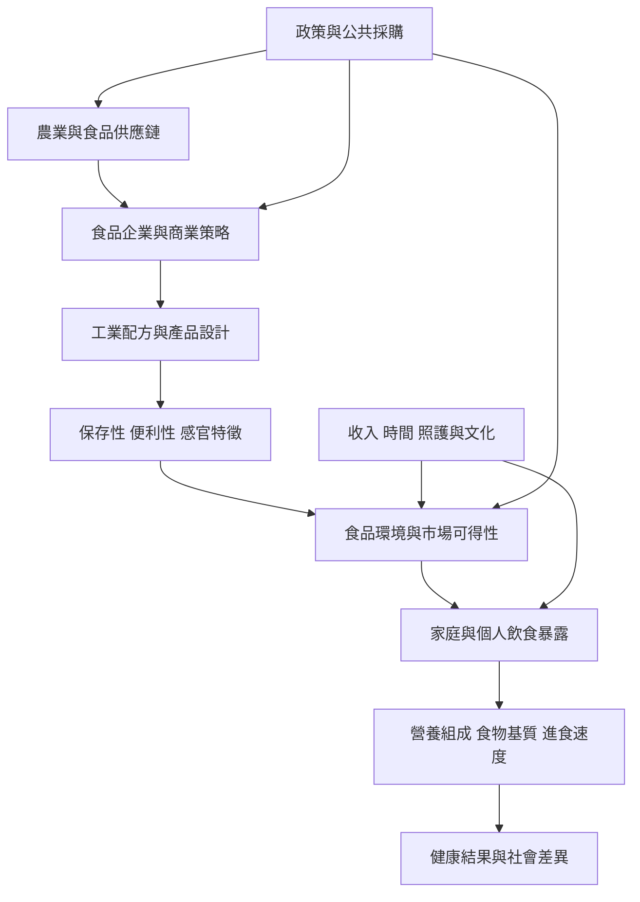

超加工食品可以放在一條由上游食品系統、產品配方、食品環境、個人暴露到健康與政策回應的因果鏈中理解。這張圖是分析框架，不代表每一條箭頭都已被單一研究證明。

建議從 [[NOVA食品分類]] 理解分類起點，再讀 [[超加工食品分類描述的是食品配方與產業邏輯而非營養分數]] 與 [[超加工食品擴張反映食品環境與商業決定因素]]，最後連接 [[減少超加工食品政策應同時改善健康食物的可負擔性]]。若要回到生活尺度，搭配 [[便利性不是個人意志缺陷而是時間與照護分配問題]] 與 [[以一週飲食觀察建立非評價式食品加工地圖]]。

## 延伸概念
[[食品加工]]、[[食物基質]]、[[食品環境]]、[[商業健康決定因素]]、[[食品主權]]、[[食物不安全]]、[[飲食轉型]]。
