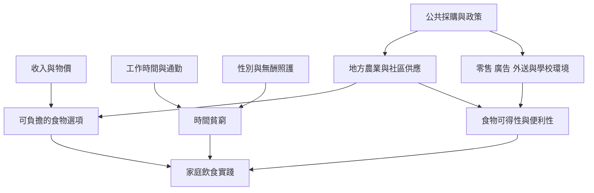

食品選擇不是脫離環境的私人決策。可負擔性、零售分布、廣告、工作時間、交通、照護責任與家庭文化，共同構成飲食行動的條件。健康政策若忽略這些因素，可能把不平等轉化為個人責備。

以 [[便利性不是個人意志缺陷而是時間與照護分配問題]] 作為核心，再連到 [[亞馬遜家庭食物不安全會推動以超加工食品替代鮮食]]、[[英國家庭飲食質性研究指出時間匱乏價格與慣習限制選擇]] 與 [[撒哈拉以南非洲超加工食品應從性別化食物勞動理解]]。實踐方向可由 [[社區共食可以把健康飲食從個人責任轉成互助基礎設施]] 和 [[用食物時間帳本辨認方便食品背後的照護勞動]] 延伸。

## 延伸概念
[[食品環境]]、[[商業健康決定因素]]、[[食物不安全]]、[[食品主權]]、[[時間貧窮]]。
