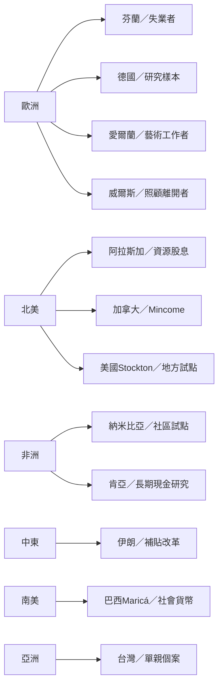

各地案例的名稱相似，但制度差異很大。芬蘭針對失業者；德國是研究樣本試驗；阿拉斯加是資源收益年度股息；伊朗是能源補貼改革後的大規模現金移轉；納米比亞是單一社區試點；愛爾蘭與威爾斯是特定職業或群體政策；Stockton 與台灣案例屬地方或個案試驗；Maricá 則結合社會貨幣與地方福利。

連結：[[data/芬蘭2017至2018年試驗改善主觀福祉但就業效果有限]]、[[data/德國每月一千二百歐元三年試驗未發現退出勞動市場]]、[[data/阿拉斯加永久基金股息研究未發現整體就業下降]]、[[data/加拿大明尼托巴Mincome再分析發現住院率相對下降]]、[[data/納米比亞奧吉維羅試點呈現貧窮與兒童營養改善但研究外推有限]]、[[data/肯亞長期現金移轉試驗比較長期定期給付短期給付與一次性給付]]、[[data/伊朗大規模現金給付研究未支持勞動供給普遍下降]]、[[data/巴西Maricá的公民基本收入以地方社會貨幣發放但資格並非全體普遍]]、[[data/台灣單親家庭基本收入試驗提供在地個案但不能推論全國效果]]。
