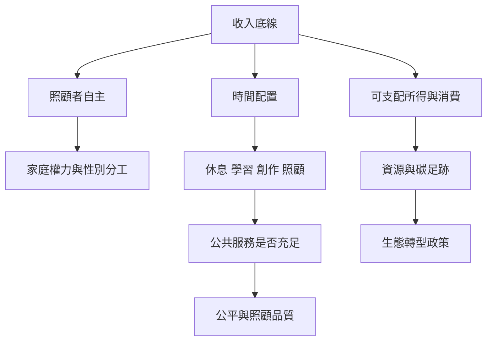

基本收入的社會效果取決於它如何與家庭分工、公共照顧、勞動時間及生態限制相連。收入可能提升照顧者自主，也可能讓既有性別分工更穩固；可能給人減少有薪工時的空間，也可能增加消費。現金需要與公共服務、照顧制度及生態轉型政策共同設計。

連結：[[data/基本收入與女性主義的爭論聚焦於解放還是補貼無償照顧]]、[[data/愛爾蘭藝術基本收入試點顯示穩定收入可擴展創作時間]]、[[data/基本收入的去成長論述仍需要補足制度與實證研究]]、[[note/無條件收入可能提升照顧者自主也可能固化性別分工]]、[[note/基本收入不會自動帶來生態永續或縮短工時]]。
