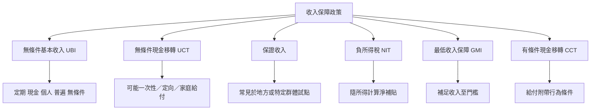

這張概念地圖先釐清「UBI 是什麼」，再辨認相鄰制度。核心不是名稱，而是給付對象、條件、支付單位、頻率與資源形式。當方案不是向所有個人定期無條件給付時，應保留其政策類型的準確名稱。

連結：[[term/無條件基本收入（UBI）]]、[[term/無條件現金移轉（UCT）]]、[[term/保證收入（Guaranteed Income）]]、[[term/負所得稅（NIT）]]、[[term/最低收入保障（GMI）]]、[[term/有條件現金移轉（CCT）]]、[[note/全民基本收入的定義必須同時符合普遍個人定期現金與無條件]]。
