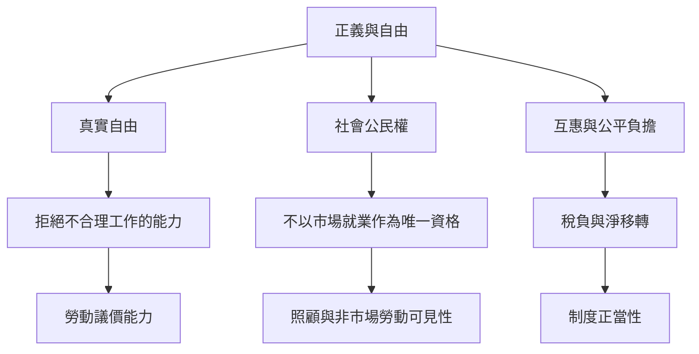

UBI 的規範辯論不只在於消除貧窮，也涉及一個人是否必須依賴雇主、家庭或救助審查才有生存資源。支持者常以真實自由、議價能力與社會共同財富為理由；批評者則追問是否公平地對待有薪勞動者、是否削弱針對性福利、是否讓不平等的財富結構原封不動。

連結：[[term/真實自由（Real Freedom）]]、[[term/社會公民權]]、[[term/照顧與非市場勞動]]、[[note/基本收入的爭論同時是經驗問題與價值選擇]]、[[note/無條件收入可能提升照顧者自主也可能固化性別分工]]。
