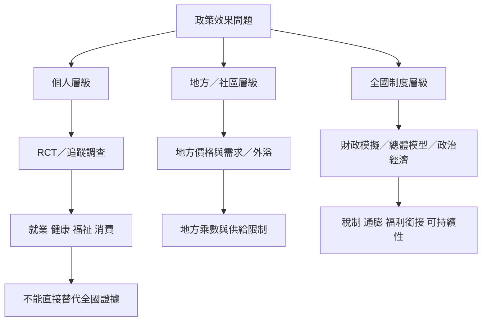

UBI 研究常見的難題，是不同研究回答不同層次的問題：個人受益者的短期效果、地方市場的外溢效果，以及全國永久制度的總體效果。證據地圖應同時標示研究設計、樣本代表性、給付規模與外推限制。

連結：[[data/低中所得國家一百一十五項研究的統合分析支持多項無條件現金移轉結果]]、[[data/芬蘭2017至2018年試驗改善主觀福祉但就業效果有限]]、[[data/德國每月一千二百歐元三年試驗未發現退出勞動市場]]、[[data/小規模基本收入試辦難以回答普遍且永久制度的效果]]、[[note/無條件現金移轉的正面證據不能自動等同UBI證據]]、[[note/小規模試辦不能回答全國制度的財政與通膨問題]]。
