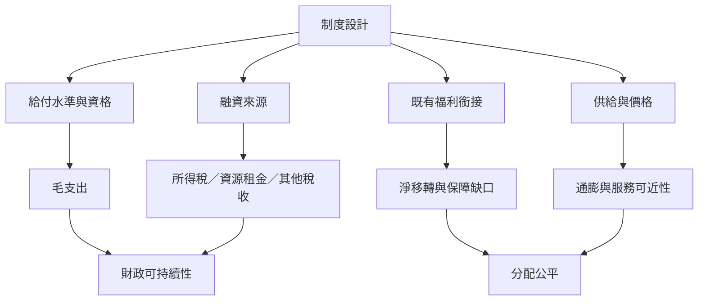

給付金額、人口覆蓋率、稅收回收、原有福利是否保留、地方供給能力與價格反應，決定 UBI 的淨分配效果與財政可行性。制度模擬不能只計算「月額乘總人口」，也不能只把預算總額與 GDP 比較；需要呈現稅後淨移轉與公共服務影響。

連結：[[data/經濟合作暨發展組織要求把基本收入放進整體福利改革計算]]、[[data/國際貨幣基金組織以覆蓋率慷慨度累進性與融資評估UBI]]、[[note/基本收入的公平性要看稅後淨移轉而非毛額給付]]、[[note/現金給付的成效依賴地方市場與公共服務條件]]、[[term/邊際有效稅率]]、[[term/一般均衡效果]]。
