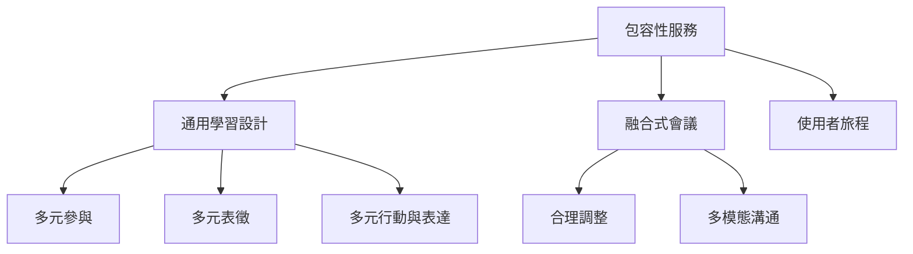

通用學習設計可與社群活動、會議和公共服務互相借鑑：預先提供多種參與與表達方式，並保留個別合理調整。成功不只是讓人進場，而是讓不同人能有意義地參與。

延伸閱讀：[[通用學習設計]]、[[多模態溝通]]、[[合理調整]]、[[使用者旅程]]、[[認知可及性]]。

## 參考
* [[CAST 的 UDL 3.0 將偏見與系統性排除納入學習設計]]
* [[台灣融合式會議指引區分可及性通用設計與合理調整]]
* [[UDL 系統性回顧支持其潛力但提醒目前研究異質性高]]
