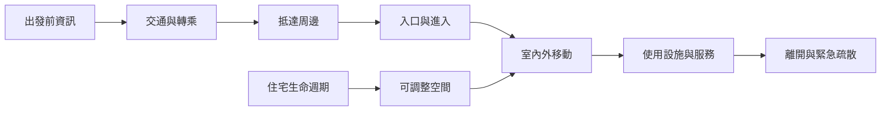

建築可及性必須從抵達、進入、室內移動、使用服務、休息到離開形成連續旅程。住宅還應考慮生命週期變化，公共空間則應把交通、資訊與人際服務一起納入。

延伸閱讀：[[使用者旅程]]、[[無障礙旅遊]]、[[生命週期設計]]、[[可及性]]、[[通用設計]]。

## 參考
* [[ISO 21542 將建築可及性落實於進出移動與疏散]]
* [[ISO 21902 將可及性延伸至整條旅遊供應鏈]]
* [[日本以無障礙法結合硬體改善與社會意識措施]]
* [[台灣建研所將通用住宅視為能隨生命週期調整的居住環境]]
