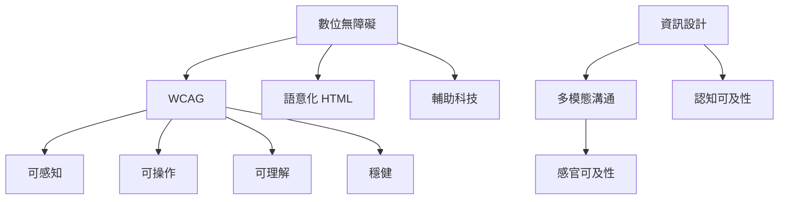

數位可及性需要把內容結構、操作方式、資訊表徵、輔助科技與真實任務測試連成一體。多模態設計與認知可及性可以降低資訊只對單一感官或單一理解方式開放的風險。

延伸閱讀：[[數位無障礙]]、[[WCAG]]、[[語意化 HTML]]、[[多模態溝通]]、[[認知可及性]]、[[感官可及性]]、[[輔助科技]]。

## 參考
* [[WCAG 2.2 將數位可及性轉化為可測試的成功準則]]
* [[台灣網站無障礙政策以 WCAG 衍生規範作為公共部門基線]]
* [[數位無障礙需要標準檢測與真實使用者測試]]
