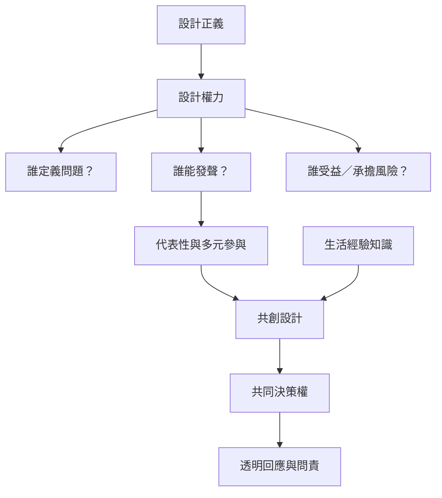

通用設計若只由專業者替他人定義需求，可能複製既有權力不平等。設計正義、共創與參與式設計要求檢查代表性、決策權、報酬與社群問責。

延伸閱讀：[[設計正義]]、[[共創設計]]、[[參與式設計]]、[[使用者專家]]、[[普遍性]]。

## 參考
* [[Design Justice 將設計權力移向受影響社群]]
* [[2026 共創範疇回顧指出障礙者參與常受決策權與方法可及性限制]]
* [[瑞典障礙團體研究顯示代表制度也會形塑誰能發聲]]
* [[共創只有具備決策權才不會淪為象徵性參與]]
