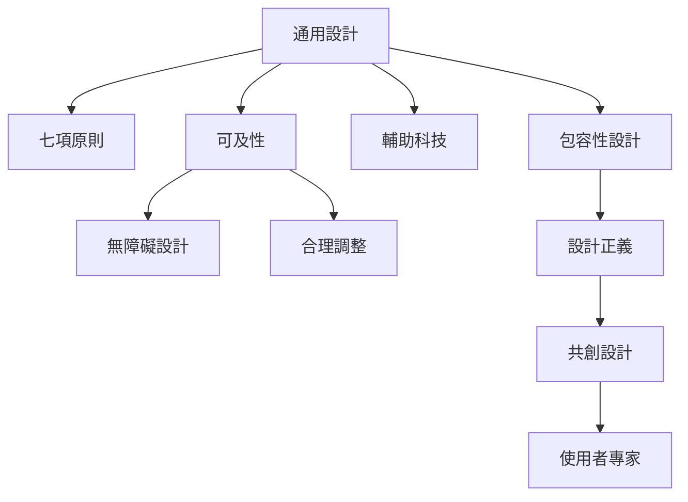

通用設計是全書的核心概念，但它必須與可及性、無障礙設計、合理調整、輔具和設計正義一起理解。七原則提供檢查框架，權利公約則界定制度責任與個別權利。

延伸閱讀：[[通用設計]]、[[可及性]]、[[合理調整]]、[[輔助科技]]、[[無障礙設計]]、[[包容性設計]]、[[設計正義]]、[[共創設計]]、[[使用者專家]]。

## 參考
* [[聯合國公約將通用設計合理調整與輔具放在同一權利框架]]
* [[通用設計七原則提供跨領域的使用性評估框架]]
* [[通用設計追求最大可用性而不是宣稱人人都能完美使用]]
