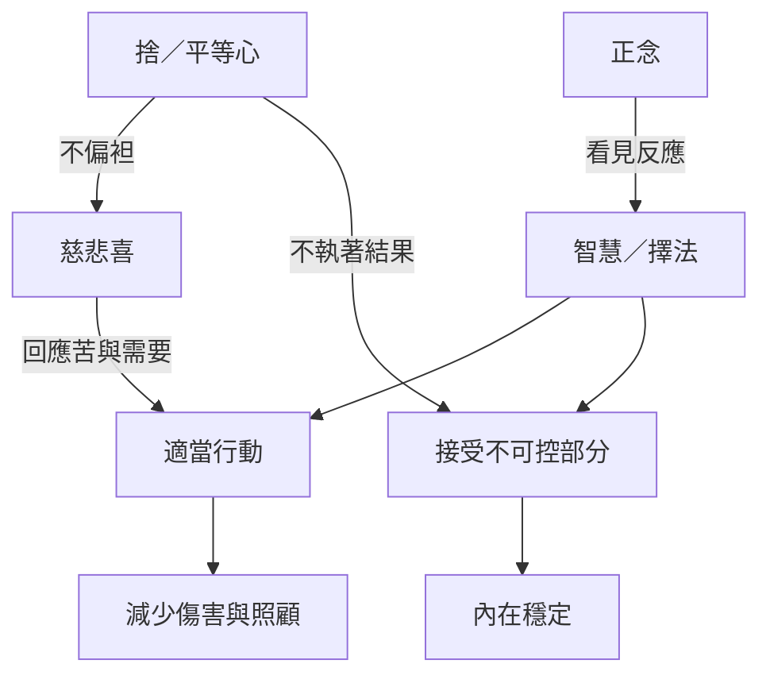

這張地圖呈現捨心不是孤立的退離，而是和慈悲、智慧、正念及行動判斷共同運作。當能辨認他人受苦，慈悲推動介入；當結果不受控制，捨使人放下徒勞執著；智慧則判斷什麼時候應努力、什麼時候應停手。

核心概念：[[Upekṣā／Upekkhā]]、[[四梵住]]、[[慈]]、[[悲]]、[[喜]]、[[正念]]、[[精進]]。

## 思與行
* 用「能否減少傷害」與「是否執著結果」兩個問題，檢查自己的反應是否同時具備慈悲與捨。

## 參考
* [[早期佛教不把袖手旁觀當成平等心的最高表現]]
* [[平等心需要判斷力才能在適當時候採取行動]]
