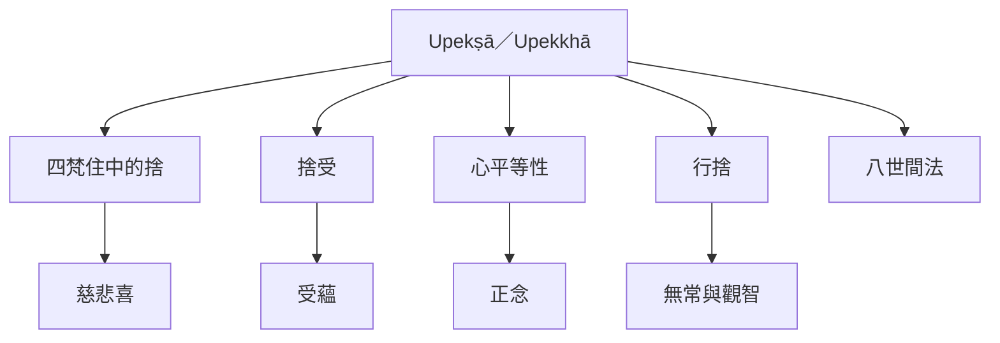

Upekṣā 的語義至少涉及關係倫理、心理平衡、禪修因素與受蘊感受。這張地圖先拆出詞義，避免把捨受、心平等性與四梵住的捨混為一談。

核心概念：[[Upekṣā／Upekkhā]]、[[四梵住]]、[[受蘊]]、[[捨受]]、[[心平等性]]、[[行捨]]、[[八世間法]]、[[無常]]、[[正念]]、[[慈]]、[[悲]]、[[喜]]。

## 思與行
* 每次遇到「捨」字，標記它在原文中屬於感受、心所、禪定、四梵住或觀智哪一層。

## 參考
* [[阿毘達磨區分捨受與平衡心的倫理功能]]
* [[量表研究以經驗接納與非反應性測量平等心]]
