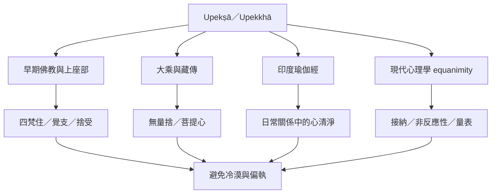

跨文化比較可同時觀察佛教巴利與梵文傳統、印度瑜伽，以及現代心理學的 equanimity 構念。相似的語詞可能處理相近問題，卻不必然共享相同宗教目的或修行理論。現代研究把經驗接納與非反應性轉成測量構念，有助於研究心理機制，但不能直接取代傳統對倫理、智慧與解脫的完整理解。

核心概念：[[Upekṣā／Upekkhā]]、[[四梵住]]、[[捨波羅蜜]]、[[捨受]]、[[心平等性]]。

## 思與行
* 為不同傳統建立「語言、原典、對象、修習目的、常見誤解」五欄對照表。

## 參考
* [[瑜伽經一點三三把 upekṣā 放入日常關係的心清淨練習]]
* [[大乘與藏傳將捨心擴展為不偏愛眾生的菩提心前行]]
* [[現代冥想研究把平等心視為情緒反應調節的重要機制]]
